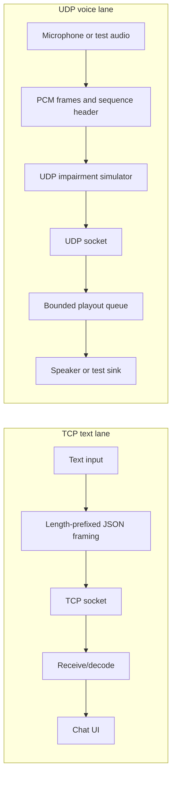

# Real-Time TCP Text and UDP Voice Chat

An educational Python desktop application demonstrating two independent transport lanes: reliable text messaging over TCP and low-latency voice packets over UDP.

## Implemented features

- TCP text chat using length-prefixed JSON message framing.
- UDP voice transport carrying raw int16 PCM packets with sequence and timestamp metadata.
- Tkinter desktop interface with separate text and voice inspectors.
- UDP-only impairment simulator for packet loss, delay, jitter, and reordering.
- Session metrics, timestamped event logging, and CSV export.
- Explicit test-audio mode that sends silent PCM over real UDP sockets when microphone/speaker hardware is unavailable.
- Automated protocol, metrics, network-simulator, worker, and localhost TCP/UDP integration tests.

## Architecture



TCP provides reliable ordered byte delivery; application framing defines complete messages. UDP transports real-time PCM frames without TCP-style retransmissions. The simulator operates on outbound UDP traffic only; intentionally injected conditions are labelled as simulated.

## Requirements

- Python 3.10 or newer.
- Desktop environment for the Tkinter UI.
- `sounddevice` and an available PortAudio microphone/speaker device for real voice. Test-audio mode does not require audio hardware.

## Install and run

From the repository root:

```bash
python -m venv .venv
# macOS/Linux
source .venv/bin/activate
# Windows PowerShell: .venv\Scripts\Activate.ps1
python -m pip install --upgrade pip
python -m pip install -r requirements.txt
python app.py
```

Run checks without opening the GUI:

```bash
python -m pytest
python app.py --self-test
```

On 2026-10-19, validation in the available Linux environment reported **13 passed** for `python -m pytest`. The headless integration self-test also passed, exchanging messages over real localhost TCP sockets and exercising real localhost UDP sockets with silent test audio. Physical microphone/speaker behavior and multi-computer LAN/WAN connectivity were not verified in that environment.

## Run a two-peer demonstration

For local testing on one computer, run two app instances:

| Setting | Host instance | Client instance |
|---|---|---|
| Peer IP | `127.0.0.1` | `127.0.0.1` |
| TCP port | `51000` | `51000` |
| Local UDP port | `51001` | `51002` |
| Peer UDP port | `51002` | `51001` |

Start **HOST** first, then **CONNECT** from the client. Send text in both directions, then select **START TEST AUDIO** to prove voice packet flow before trying **START REAL VOICE**. For LAN operation, set the client's peer IP to the host's LAN IPv4 address and permit the chosen TCP/UDP ports through the operating-system firewall.

More extensive steps and troubleshooting are in [TEST_PLAN.md](./TEST_PLAN.md). See [DEPLOYMENT.md](./DEPLOYMENT.md) before attempting remote/internet access. A cleaned source archive is also available at [voice_chat_project_source.tar.gz](./voice_chat_project_source.tar.gz).

## Limitations and security

This is a desktop lab prototype, **not a browser application and not deployed online**. GitHub Pages/static hosting cannot run its persistent desktop process or expose the required UDP sockets. Cross-internet operation needs a reachable TCP host and UDP paths that survive firewall/NAT configuration. The prototype does not implement encryption, authentication, NAT traversal, codec/RTP, or production-grade VoIP security; do not use it for sensitive communications or expose it to the public internet as-is.

A browser-accessible version would require a separate WebRTC implementation, signaling, and potentially STUN/TURN. That is a future adaptation and is not claimed as part of the existing raw TCP/UDP program.
