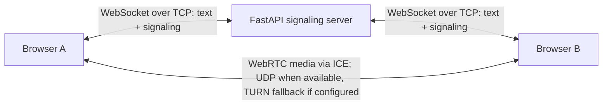

# Browser Edition

A two-person, browser-accessible text and voice demo added alongside the existing desktop TCP/UDP networking lab.

## Features

- Two-person rooms with short shareable invite codes.
- Browser microphone input, mute control, and remote audio playback.
- Peer-to-peer audio via WebRTC; signaling and text chat via WebSocket.
- WebRTC `getStats()` metrics for inbound audio packet loss, jitter, packets received, and available candidate-pair RTT.
- A live jitter graph and downloadable CSV snapshots.
- Health endpoint and optional environment-provided TURN server configuration.
- No account required for the demo; messages are only relayed live and are not stored as history.

## Architecture



The browser edition does not implement raw arbitrary UDP sockets, because normal browser JavaScript cannot open raw TCP/UDP sockets. WebRTC is the appropriate browser media transport; ICE negotiates a path and may use TURN when direct UDP is unavailable.

## Local run

From the repository root:

```bash
python -m venv .venv
source .venv/bin/activate        # Windows PowerShell: .venv\\Scripts\\Activate.ps1
python -m pip install -r web/requirements-dev.txt
python -m uvicorn web.app:app --host 127.0.0.1 --port 8000
```

Open <http://127.0.0.1:8000> in two browsers or devices. Enter the same room code and different names. Allow microphone permission on both devices. Text messages should relay through WebSocket; when ICE succeeds, the audio channel and stats should update.

Run browser-server tests:

```bash
python -m pytest web/tests -q
node --check web/static/app.js
```

Endpoints:

- `/` — application UI
- `/healthz` — service health check
- `/ice-config` — default STUN configuration plus optional TURN settings
- `/ws/{room_code}` — WebSocket room, text relay and WebRTC signaling

## Render deployment

The root `render.yaml` defines the web service. In Render, create a Blueprint from this repository and the `main` branch. The generated service uses `web/requirements.txt`, starts `uvicorn web.app:app --host 0.0.0.0 --port $PORT`, and checks `/healthz`. Render supplies HTTPS and supports WebSockets; browser clients switch to `wss://` automatically on HTTPS.

Render free web services spin down while idle; the client sends a WebSocket keepalive every 25 seconds while connected. A first visit after idle can still take time to wake. The server keeps active rooms in memory only and is intended for a single service instance.

Optional TURN settings:

| Variable | Meaning |
|---|---|
| `TURN_URLS` | Comma-separated `turn:` or `turns:` URIs |
| `TURN_USERNAME` | TURN username from the provider |
| `TURN_CREDENTIAL` | TURN credential from the provider |

TURN credentials must be passed to browsers for ICE to use them and are therefore visible to those clients. Prefer expiring credentials from a TURN provider for production rather than a permanent shared credential. Public STUN is configured by default but does not guarantee connectivity through every firewall/NAT. A TURN provider may cost money.

### Fixing “Audio link interrupted” / blank connection metrics

If text messages work but voice changes to **RETRY** and packet loss/jitter/RTT remain blank, the WebSocket signaling path is working but WebRTC has not established a media path. The default configuration uses STUN only, which cannot relay media when the peers' networks prevent a direct path.

1. Create a TURN credential with a TURN provider. Metered's Open Relay offers a free usage allowance; check the provider's current account and usage terms before use: <https://www.metered.ca/tools/openrelay/>. In its dashboard, create a TURN credential and copy the ICE server URLs, username, and credential/password.
2. In Render, open the `tcp-udp-text-voice-chat-browser` web service → **Environment** → add these three variables:
   - `TURN_URLS`: comma-separated TURN URLs from your provider's ICE server array, for example `turn:global.relay.metered.ca:80,turn:global.relay.metered.ca:80?transport=tcp,turn:global.relay.metered.ca:443,turns:global.relay.metered.ca:443?transport=tcp`. Use the exact URLs your credential page gives you.
   - `TURN_USERNAME`: the TURN credential username.
   - `TURN_CREDENTIAL`: the TURN credential password.
3. Save the environment changes and wait for Render to redeploy. Do not paste the TURN password into GitHub, source files, or chat.
4. Refresh both browsers, leave the old room, create/join the same room again from two browsers/devices, and allow microphone access on both sides.
5. The UI should now report TURN as configured if negotiation fails; if it still fails, inspect the browser console and Render logs and verify that the provider's TURN credential is active and its listed transports are allowed.

Metrics intentionally remain blank until a WebRTC peer connection is active and inbound audio RTP statistics are available. “0 received packets” means no inbound audio packets have arrived; it is not evidence that packet loss is 0%.

## Limitations

- This is a college demonstration, not a secure communications service. There is no authentication, end-to-end identity, persistent chat history, or abuse-management system.
- Room state is in-process memory; multiple server instances would not share active rooms or signaling.
- No TURN service is bundled. Voice may fail on restrictive networks unless the operator configures TURN.
- The tests verify signaling-room behaviors and served web assets. They do not emulate every browser, microphone hardware, network topology, or sustained production traffic.
- The browser adaptation's transport differs from the original program: WebSocket text/signaling and WebRTC voice; the original TCP/UDP desktop implementation remains at repository root.